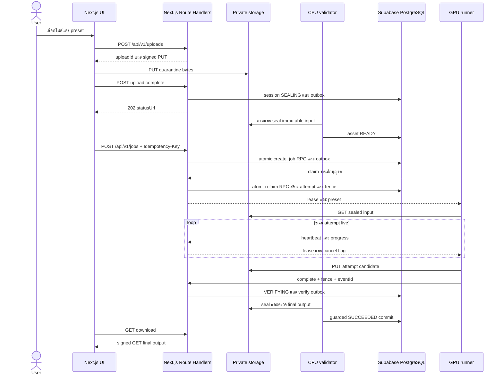

# HANDOFF สำหรับทีมพัฒนา Video Enhancer Application

เอกสารข้อกำหนดและแนวทางส่งต่อทีมพัฒนา

รุ่น 1.1 • วันที่ 13 ตุลาคม 2026 • สถานะ Proposed implementation baseline

จัดทำสำหรับทีม Fullstack, GPU และ Platform โดย Codex ตามข้อกำหนดผู้ขอ เอกสารนี้เป็นข้อเสนอสำหรับเริ่มพัฒนา ไม่ใช่รายงานระบบที่ติดตั้งแล้ว และไม่ใช่ผล benchmark

## ข้อสรุปที่ทีมต้องยึดร่วมกัน

ใช้ Next.js App Router เป็นแอป fullstack เดียว รวม GUI และ Route Handlers สำหรับผู้ใช้ การอัปโหลด และสถานะงานใน repository และ deployment เดียว ใช้ Supabase PostgreSQL เป็นฐานข้อมูล และเสนอ Supabase Auth สำหรับ login ไม่มีแอป API แยก เก็บวิดีโอใน private R2 หรือ S3 ส่วนประมวลผลแยกเป็น GPU worker ซึ่งสื่อสารผ่าน contract เดียวกัน รองรับการทดลอง Colab แบบผู้ปฏิบัติงานเลือกงานและกดรันใน notebook และเพิ่ม local GPU หรือ RunPod ภายหลังได้โดยไม่เปลี่ยน API ฝั่งผู้ใช้

MVP ใช้ Real-ESRGAN เป็น baseline เปิด SeedVR2 หลังผ่าน benchmark และตรวจ environment เท่านั้น Supabase PostgreSQL เป็นแหล่งความจริงของสถานะงาน ใช้ lease และ fencing token ป้องกัน worker เก่าเผยแพร่ผลหลัง retry ห้ามให้ browser ติดต่อ GPU โดยตรง

Colab ไม่เป็น production backend และไม่รับประกันว่าการกดรัน manual ทำให้ external GUI integration ผ่าน policy Google เสมอ เส้นทางนี้ปิดค่าเริ่มต้นจนทีมตรวจบริบทบัญชีและรูปแบบใช้งาน หากไม่เหมาะให้ใช้ local GPU หรือ RunPod แทน [S1]

## การเปลี่ยนแปลงรุ่น 1 จุด 1

เปลี่ยน web stack เป็น Next.js fullstack และฐานข้อมูลเป็น Supabase ตามคำขอล่าสุด URL หลักใช้ /api/v1 และ worker ติดต่อ origin เดียวกับ GUI ส่วน storage, model และ GPU adapters คง scope เดิม Supabase Auth เป็นสมมติฐานเสนอเพิ่มเติมจากคำขอ database; Supabase Storage และ Realtime ยังไม่เป็นข้อกำหนด MVP

## ขอบเขตหลักฐานและสมมติฐาน

บทสนทนาอ้างอิงให้บริบทเรื่อง open source enhancer และ GUI แต่ข้อความคำตอบที่ดึงได้เป็น reference จึงไม่อ้างว่าทราบคำแนะนำเดิม รายละเอียดในเอกสารนี้ยึดคำขอล่าสุดและแหล่งทางการที่ตรวจวันที่ข้างต้น ไม่มี repository, GPU inventory, งบประมาณ หรือ deployment เดิมให้ตรวจ

ตัวเลข limit, TTL, retry และระยะเวลา milestone ทั้งหมดเป็นค่าเสนอสำหรับ MVP ต้องยืนยันใน kickoff และปรับด้วยผลทดสอบจริง การเปลี่ยนข้อเสนอในเอกสารย้อนกลับง่าย R2; การนำ API contract หรือ retention policy ไปใช้งานจริงอาจเป็น R1 และต้องมี migration/rollback plan

<!-- pagebreak -->
# แผนที่เอกสารและการตัดสินใจ

## ลำดับอ่านตามบทบาท

| บทบาท | ส่วนที่ควรอ่านก่อน | สิ่งที่ต้องส่งมอบ |
|---|---|---|
| Product และ Tech lead | 1, 2, 13, 14, 15 | ยืนยัน scope, limits, คุณภาพ และ budget |
| Fullstack | 2 ถึง 8, 11, 12, 16 | Next.js UI/Route Handlers, Supabase Auth/RPC/RLS และ job orchestration |
| GPU | 4, 7, 9, 10, 16 | processing runner และ adapter ตาม contract |
| Platform และ QA | 8, 11 ถึง 15 | deployment, fault injection และ acceptance |

## สารบัญ

1 ขอบเขตและ MVP

2 สถาปัตยกรรมและความรับผิดชอบ

3 ประสบการณ์ GUI

4 Upload และ processing pipeline

5 Public API contracts

6 Worker API contracts

7 Job state machine และ cancellation

8 Idempotency retries และ leases

9 Processing model และ media integrity

10 Colab และ GPU provider adapters

11 Security และการเก็บข้อมูล

12 Deployment และ operations

13 Acceptance criteria และการทดสอบ

14 Milestones และ effort

15 Risks และ open questions

16 Code และ sequence examples

17 แหล่งอ้างอิงและสถานะการส่งต่อ

## Decision log เริ่มต้น

| ID | ข้อเสนอ | เหตุผลและเงื่อนไขทบทวน |
|---|---|---|
| D01 | Supabase PostgreSQL และ transactional outbox | ไม่ให้ queue เป็นแหล่งความจริง; เพิ่ม broker เมื่อ workload ต้องการ |
| D02 | Private storage และ direct PUT | API ไม่รับวิดีโอก้อนใหญ่; seal input ก่อน worker อ่าน |
| D03 | Real-ESRGAN baseline | แยกความเสี่ยง integration ออกจากการทดลองโมเดล |
| D04 | Colab manual และ feature flag | ไม่มี daemon, SLA หรือ policy exemption ที่รับประกัน |
| D05 | Local worker ก่อน RunPod | พิสูจน์ provider-independent contract ก่อนมีค่า GPU cloud |
| D06 | Next.js fullstack แอปเดียว | UI และ API ใช้ origin/repository/deployment เดียว |
| D07 | Supabase RPC สำหรับ atomic mutation | ไม่แยก DB transaction เป็นหลาย HTTP requests |

<!-- pagebreak -->
# 1 ขอบเขตและ MVP

## เป้าหมายและผู้ใช้

ให้ผู้ใช้ที่ล็อกอินอัปโหลดวิดีโอ เลือก preset สร้างงาน ดูสถานะ ยกเลิก และดาวน์โหลดผล ผู้ปฏิบัติงานทดลองเรียกงานใน Colab ด้วยตนเองได้เมื่อผ่าน policy gate ความสำเร็จของ MVP คือ pipeline ที่ตรวจสอบได้และกู้คืนจาก worker หลุดได้ ไม่ใช่คำมั่นว่าจะกู้รายละเอียดจริงที่ไม่มีอยู่ในต้นฉบับ

## สิ่งที่รวมใน MVP

• Next.js responsive GUI พร้อม upload progress, job history, error ที่เข้าใจได้ และ side-by-side preview จากวิดีโอที่ได้รับอนุญาต

• Next.js Route Handlers REST API รุ่น /api/v1 พร้อม Supabase Auth, ownership, quotas, idempotency และ OpenAPI จาก shared schemas

• R2 หรือ S3 adapter, upload session, sealing, CPU media validation, private download URL และ retention cleanup

• Job orchestration แบบ asynchronous, attempt history, lease heartbeat, cancellation และ audit events

• Python GPU runner สำหรับ Real-ESRGAN, FFmpeg encoding และ local adapter; Colab one-shot path แบบทดลอง

• Mock GPU runner สำหรับ CI และ provider interface สำหรับ RunPod Pods/Serverless ในระยะถัดไป

## ค่าเริ่มต้นที่เสนอ

| รายการ | ข้อกำหนด MVP ที่เสนอ |
|---|---|
| Input | MP4, H.264, SDR 8-bit, CFR; audio AAC หรือไม่มีเสียง |
| ขนาดและเวลา | ไม่เกิน 500 MiB และ 120 วินาที |
| Resolution และ FPS | ไม่เกิน 1920×1080, 30 fps; portrait ได้ภายใต้ pixel budget เท่ากัน |
| Output | MP4 H.264 yuv420p + AAC, dimension เป็นเลขคู่, SDR |
| Preset | 2× และ 4×; output ไม่เกิน 3840×2160 หรือ pixel budget เทียบเท่า |
| งานพร้อมกัน | 1 active GPU attempt ต่อ worker; 2 nonterminal jobs ต่อผู้ใช้ |
| Retention | input/output 7 วัน; incomplete upload 24 ชั่วโมง; scratch หลัง attempt จบ |
| Retry | สูงสุด 3 attempts รวมครั้งแรก; ไม่มี fallback โมเดลเงียบ ๆ |

ตรวจ limit ด้วย metadata จริง ไม่เชื่อค่าที่ browser แจ้ง ผู้ใช้ได้รับ 422 เมื่อ input ไม่รองรับ และต้องเห็นเหตุผลก่อนจอง GPU งาน 1080p 4× ที่เกิน output budget ต้องปฏิเสธหรือให้เลือก 2× ไม่ลด scale เอง

## สิ่งที่อยู่นอก MVP

ไม่รวม billing, anonymous upload, public sharing, live streaming, batch folders, subtitle preservation, HDR, VFR, frame interpolation, face restoration, training, arbitrary command/model URLs และ production service ที่ใช้ Colab โดยอัตโนมัติ SeedVR2 เป็น experimental feature ไม่เป็น acceptance dependency ของ MVP แรก

<!-- pagebreak -->
# 2 สถาปัตยกรรมและความรับผิดชอบ

## Component map

```text
Browser
  | same-origin HTTPS             | signed PUT / GET
Next.js fullstack app ---------- Private R2 / S3
  | App Router UI + Route Handlers       ^ video bytes
  | verified user + server-only RPC      |
Supabase Auth + PostgreSQL       CPU / GPU processing tasks
  | jobs / attempts / outbox             |
Background tasks from same app repo -----|
  | provider adapter contract
Colab manual | local GPU | RunPod Pods | RunPod Serverless
```

Next.js เป็น web application เดียว UI ใช้ Server Components สำหรับข้อมูลที่ต้องตรวจสิทธิ์ และ Client Components สำหรับ upload/player/progress Route Handlers อยู่ใน app/api/v1/**/route.ts และใช้ Node.js runtime สำหรับ signing/SDK ไม่มี backend API project หรือ origin แยก [S7]

GPU worker เป็น processing infrastructure ที่ยังต้องแยกจาก web runtime CPU validator, dispatcher และ reaper เป็น background task entry points ใน app repository/release เดียวกัน ไม่เป็น web backend อีกแอป เสนอ deploy เป็น Node container ที่ supervisor ดูแล web และ task processes พร้อม resource limits หากภายหลังใช้ serverless web ต้องจัด durable task host แทน ห้ามถือว่า HTTP handler จะรันงานต่อหลังตอบ 202 [S11]

## ความรับผิดชอบและ ownership

| Component | รับผิดชอบ | ข้อห้าม |
|---|---|---|
| Next.js UI | login, upload, presets, status, download | ห้ามเก็บ server secret หรือ provider key |
| Next.js Route Handlers | auth, URLs, job transitions, quota | ห้ามรัน GPU/FFmpeg หรือ daemon ใน HTTP request |
| Supabase Auth | identity, sessions, login providers | ห้ามใช้ getSession อย่างเดียวตัดสิน server authorization |
| Supabase PostgreSQL | state, atomic RPC, leases, outbox | ห้าม client เขียน state/fence ได้โดยตรง |
| Background tasks | seal, validate, dispatch, retry, reaper | ห้ามผูก task lifecycle กับ request lifetime |
| GPU runner และ adapter | media processing, provider lifecycle | ห้าม publish result หรือเข้าถึง DB โดยตรง |

## Supabase data access และ transactions

ใช้ auth.users เป็น identity หลัก และ public.profiles เฉพาะข้อมูล profile ที่จำเป็น Business tables อยู่ใน private schema ที่ไม่เปิดผ่าน Data API ได้แก่ assets, upload_sessions, jobs, job_attempts, job_events, dispatch_intents, outbox_events, account_quotas และ idempotency_records owner_id อ้าง auth.users.id ส่วน role operator เก็บ server-managed membership ที่ผู้ใช้แก้เองไม่ได้

MVP browser เรียก Supabase สำหรับ Auth เท่านั้น ข้อมูล jobs/assets อ่านและเขียนผ่าน Next.js ทุกครั้ง Public profiles ถ้าเปิดให้อ่านต้องมี RLS owner policy และจำกัด columns ส่วน private business tables เปิด RLS เป็น defense in depth และ revoke schema/table access จาก anon/authenticated ไม่เปิด state mutation policy

สร้าง public RPC wrappers ที่ scope แคบสำหรับ Route Handlers โดย revoke EXECUTE จาก PUBLIC, anon และ authenticated แล้ว grant เฉพาะ service_role Routine ที่ต้องเข้าถึง private tables ใช้ SECURITY DEFINER อย่างจำกัด, search_path ว่าง, qualified table names และ owner/worker guards ภายในทุก function [S9] Next.js ส่ง ownerId ที่ได้จาก verified auth context ไม่รับจาก body

create_job, claim_job, heartbeat_attempt, accept_completion, cancel_job และ publish_verified_result ต้องเป็นหนึ่ง Postgres function invocation ต่อ atomic operation ฟังก์ชันเดียว lock job/attempt ตรวจ fence/state/quota แล้ว commit state + outbox + idempotency receipt การเรียก supabase.from(...).update หลายครั้งผ่าน HTTP ไม่ได้เป็น transaction เดียว

create_job lock account_quotas row ของ owner ก่อนนับ active jobs เพื่อป้องกันสอง request ผ่าน quota พร้อมกัน ตรวจ asset ownership/retention ซ้ำใน transaction เดียวกัน และล็อก idempotency key ด้วย unique constraint/receipt guard ห้ามนับ quota ที่ Next.js ก่อน RPC แล้วถือว่าเพียงพอ

Supabase secret client ใช้เฉพาะ server/tasks และแยกจาก cookie-aware user client เพราะ service_role bypass RLS; function ต้องตรวจ ownership เอง ห้ามส่ง secret key, database URL หรือ service token ให้ browser/GPU worker [S9, S10]

job fields: owner_id, input_asset_id, preset_version, provider_mode, state, version, fencing_token, cancel_requested_at, next_attempt_at, current_attempt_id และ expires_at Attempt เก็บ worker_id, lease_expires_at, provider_job_id, stage, model/weight/image revisions, input hash และ candidate key Index อย่างน้อย (state, next_attempt_at), (owner_id, created_at), active lease expiry และ unique (job_id, attempt_number)

Supabase PostgreSQL row lock/SKIP LOCKED และ outbox เป็น queue baseline ไม่เพิ่ม Redis/Realtime ใน MVP Realtime หากเพิ่มใช้สำหรับแจ้ง UI เท่านั้น ห้ามแทน queue, lease heartbeat หรือ authoritative state Migrations อยู่ใน supabase/migrations และสร้าง TypeScript Database types ใหม่ทุก schema change

<!-- pagebreak -->
# 3 ประสบการณ์ GUI

## หน้าจอและ flow

หน้า Upload ให้เลือกไฟล์ แสดง limit ที่ server ส่งผ่าน GET /api/v1/capabilities เลือก Real-ESRGAN preset และแสดงขนาด output ที่คาดการณ์จาก metadata ที่ตรวจแล้ว ก่อนยืนยันต้องแจ้งว่า enhancement อาจสร้างรายละเอียดที่ไม่ตรงต้นฉบับและไม่ได้รับประกันเวลาประมวลผล

แยก upload progress จาก processing progress ชัดเจน เมื่อ upload สำเร็จยังต้องรอตรวจไฟล์ระหว่าง SEALING ห้ามแสดงว่าพร้อมประมวลผลก่อน asset เป็น READY งาน Colab แสดง WAITING_MANUAL พร้อมข้อความ “รอผู้ปฏิบัติงานเปิด notebook และกดรัน” ไม่ใช้ ETA ของ GPU cloud

หน้า Job detail แสดง stage, attempt count, เวลารอ, เวลาประมวลผล, preset/model version และ error ที่ผู้ใช้แก้ได้ ดู progress ทุก 3 วินาทีขณะ active และทุก 10 วินาทีขณะรอ หยุด polling เมื่อ terminal หรือ tab ไม่ active แล้ว refresh เมื่อกลับมา ใช้ GET polling ใน MVP; SSE เป็นทางเลือกภายหลังและต้องรองรับ reconnect

Preview เล่นผลลัพธ์เมื่อ SUCCEEDED เท่านั้น ใช้ signed GET ที่ต่ออายุได้หลังตรวจ ownership ปรับ playback ให้ input/output อยู่ timestamp เดียวกัน ไม่ถือว่า browser เล่นได้เป็นหลักฐานว่าไฟล์ทั้งคลิปถูกต้อง ปุ่ม Download ขอ URL ใหม่ทุกครั้ง ไม่บันทึก URL ลง history หรือ analytics

## UX ของความผิดพลาด

| เหตุการณ์ | ข้อความ/พฤติกรรมที่ต้องมี |
|---|---|
| PUT URL หมดอายุ | ขอ URL ใหม่ใน session เดิมและ upload ใหม่; ไม่สร้าง job ซ้ำ |
| Format ไม่รองรับ | แสดง codec/FPS/HDR ที่ตรวจพบและข้อกำหนดที่รองรับ |
| GPU ไม่พร้อม | แสดงสถานะรอและเหตุผล; ไม่มี success/ETA ปลอม |
| Lease หมดอายุ | แสดง RETRY_WAIT หรือ WAITING_MANUAL และ attempt ใหม่ |
| Cancel pending | แสดง “กำลังยกเลิก” จน server ยืนยัน CANCELLED |
| Download หมด retention | แสดง EXPIRED พร้อมตัวเลือกอัปโหลดต้นฉบับใหม่ |
| Upload ถูกตัดกลางทาง | session ยังไม่ READY; retry ก่อน session expiry |

Client ใช้ same-origin /api/v1 ค่า NEXT_PUBLIC_* มีเพียง Supabase URL/publishable key และ flags ที่เปิดเผยได้ Supabase SSR ใช้ @supabase/ssr และ session refresh ตาม version ที่ pin Server ตรวจ token ด้วย getClaims หรือ getUser ตามระดับ freshness ไม่เชื่อ getSession อย่างเดียว [S8] Mutation ตรวจ CSRF/Origin และหน้า operator ตรวจ role ที่แก้โดย serverเท่านั้น Job/session responses ใช้ Cache-Control: private, no-store ห้าม shared cache ปุ่ม Colab ไม่ใส่ token ใน URL และไม่สั่งเปิด runtime อัตโนมัติ

Accessibility gate: label ทุก field, keyboard navigation, focus หลัง error, ไม่ใช้สีอย่างเดียวแทน state และไม่ autoplay วิดีโอที่มีเสียง

<!-- pagebreak -->
# 4 Upload และ processing pipeline

## รับไฟล์และ seal input

1 ผู้ใช้ POST upload session ด้วย filename, declared size และ MIME API ตรวจ quota/ownership สร้าง random upload key ใน quarantine และให้ signed PUT อายุ 15 นาทีพร้อม required headers [S4]

2 Browser PUT bytes ตรง storage ห้ามส่ง user bearer token ไป storage ชื่อไฟล์ใช้เพื่อแสดงผลเท่านั้น ไม่ใช้เป็น object key หรือ shell argument

3 POST complete ระบุ uploadId API lock session ตรวจ HEAD และขนาดจริง การเรียกซ้ำคืน operation เดิมด้วย 202 ระหว่างกำลัง seal และไม่ enqueue ซ้ำ

4 CPU validator อ่าน quarantine object ลง scratch ที่จำกัดขนาด คำนวณ SHA-256 จาก bytes และตรวจ decoder metadata สร้าง sealed object ด้วย internal key ใหม่ที่ไม่เคยแจก PUT ให้ client จาก bytes ชุดเดียวกับที่ตรวจ ไม่ถือว่า ETag เป็น SHA-256

5 sealed object ต้องเขียนครั้งเดียว อ่าน hash กลับตรวจหรือใช้ checksum ที่ backend รองรับและทดสอบแล้ว หากเลือก server-side copy ต้องผูกกับ source version/conditional read ที่พิสูจน์ได้ แล้วตรวจ destination ก่อน READY ห้ามใช้ HEAD แล้ว copy mutable key โดยไม่มี guard

6 asset เป็น READY เมื่อ sealing และ validation สำเร็จ; ผิด format เป็น REJECTED พร้อม error quarantine ยังแก้ไขได้จาก URL ที่ไม่หมดอายุ แต่ไม่มีผลต่อ sealed input ที่ GPU ใช้

## สร้างงานและประมวลผล

7 POST /api/v1/jobs ใช้ READY asset ของ owner เท่านั้น ตรวจ preset compatibility, retention และ pixel/frame budget แล้วสร้าง job พร้อม outbox ใน DB transaction

8 Provider resolver route ไป WAITING_MANUAL สำหรับ Colab หรือ QUEUED สำหรับ local/RunPod ผู้ปฏิบัติงาน Colab เลือก job เดียวด้วย pairing ticket ไม่ subscribe queue

9 Worker preflight GPU/model ก่อน claim เพื่อไม่ให้เสีย lease ระหว่างดาวน์โหลด weights จากนั้น atomic claim สร้าง attempt/fence และเริ่ม heartbeat ระหว่าง download, decode, enhancement, encoding และ upload

10 Worker อ่าน sealed input ผ่าน short-lived GET URL ประมวลผลใน per-attempt scratch รักษา frame order/FPS/audio แล้วอัปโหลด candidate output ลง key เฉพาะ attempt ตัว candidate ยังไม่ใช่ published result

11 Worker complete ส่ง candidate metadata API รับเป็น VERIFYING แล้ว CPU verifier seal output candidate เป็น final internal key ที่ workerไม่มีสิทธิ์ overwrite ตรวจ hash, decode, frame count, duration, audio และ output limits ก่อน atomic SUCCEEDED commit

12 GUI ได้ signed GET สำหรับ final sealed output เฉพาะหลัง SUCCEEDED; cleanup ลบ scratch/orphans ตาม retention โดยไม่ลบ active attempt

Input/output validation ต้องมี timeout และ resource cap การ probe สำเร็จไม่พอ ต้อง smoke-decode หรือ full-decode ตาม gate ที่กำหนดในส่วน 13 ไม่แยกไฟล์เป็นทุก frame ลงดิสก์โดยไม่คำนวณ storage budget

<!-- pagebreak -->
# 5 Public API contracts

## กติกากลาง

HTTPS, JSON, /api/v1, opaque UUID, UTC ISO 8601 และ camelCase ทุก Route Handler ตรวจ owner จาก verified Supabase auth context ไม่รับ ownerId จาก body POST ที่สร้าง resource ใช้ Idempotency-Key เก็บ 24 ชั่วโมงโดยผูก user+route+canonical body hash; key เดิม body ต่างคืน 409 response replay ไม่ควรคืน signed URL ที่หมดอายุ ให้ refresh URL ผ่าน route เฉพาะ

| Method และ path | Request สำคัญ | Response และกติกา |
|---|---|---|
| GET /capabilities | ไม่มี | 200 limits, presets, provider availability |
| POST /uploads | filename, sizeBytes, contentType | 201 uploadId, assetId, putUrl, headers, expiresAt |
| POST /uploads/{id}/refresh | ไม่มี | 200 URL ใหม่; เฉพาะ OPEN session และ owner |
| POST /uploads/{id}/complete | ไม่มี | 202 assetId, statusUrl; READY แล้วคืน 200 |
| GET /assets/{id} | ไม่มี | 200 state, media metadata หรือ rejection |
| POST /jobs | inputAssetId, presetId, providerMode | 201 jobId, state, statusUrl |
| GET /jobs | cursor, limit ≤ 50 | 200 เฉพาะงาน owner, nextCursor |
| GET /jobs/{id} | ไม่มี | 200 state, stage, progress, attempts, version |
| POST /jobs/{id}/cancel | ไม่มี | 202 pending; cancelled แล้ว 200; สำเร็จแล้ว 409 |
| POST /jobs/{id}/retry | ไม่มี | 201 job ใหม่ parentJobId; เฉพาะ FAILED และ asset ยังอยู่ |
| GET /jobs/{id}/download | ไม่มี | 200 getUrl, expiresAt; SUCCEEDED เท่านั้น |
| DELETE /jobs/{id}/data | ไม่มี | 202 tombstone + cleanup; active job ต้อง cancel ก่อน |

providerMode enum: local, colab_manual, runpod_pod, runpod_serverless ค่า unavailable คืน 422; ไม่มี auto fallback เปลี่ยนค่าใช้จ่ายเอง Retry route เป็นการเริ่ม job ใหม่โดย explicit user action ต่างจาก automatic attempt retry ภายใน job เดิม

```json
{"inputAssetId":"asset-uuid","presetId":"realesrgan-general-2x-v1",
 "providerMode":"local"}
```

```json
{"jobId":"job-uuid","state":"RUNNING","stage":"enhance",
 "progress":{"processedFrames":300,"totalFrames":900},
 "attemptCount":1,"version":6,"cancelRequested":false,
 "outputAssetId":null,"error":null}
```

## Errors

Error envelope: {"error":{"code":"INPUT_UNSUPPORTED","message":"รองรับ CFR SDR เท่านั้น","retryable":false,"requestId":"req-uuid","details":{"reason":"VFR"}}} ห้ามส่ง stack trace, URL signature หรือ path เครื่อง worker

401 session ไม่ถูกต้อง, 403 operator scope ไม่พอ, 404 resource ไม่พบหรือไม่ใช่ owner, 409 state/idempotency conflict, 413 ขนาดเกิน, 422 input/preset ไม่รองรับ, 429 quota/rate limit พร้อม Retry-After และ 503 backend unavailable รายละเอียดที่ UI ต้องแปลให้ใช้ error code คงที่ ไม่ parse message

<!-- pagebreak -->
# 6 Worker API contracts

## Trust และ worker session

User session ใช้สร้าง/ดูงาน ส่วน worker token คนละ audience และ scope ไม่ใช้ user JWT เป็น worker JWT Enrollment สำหรับ local/RunPod ใช้ operator credential ที่ rotate ได้ Colab ใช้ one-time pairing ticket ผูก operator, jobId และอายุ 5 นาที แลกผ่าน notebook เป็น worker session; ห้ามเปิด global claim ให้ Colab

Worker session อายุเสนอ 15 นาทีและต่ออายุเมื่อ session ยังได้รับอนุญาต อายุรวมไม่เกิน deadline งาน Pairing ticket ใช้ได้ครั้งเดียวและ revoke ได้ เซิร์ฟเวอร์ส่ง capabilities ที่อนุญาตจาก registry ที่ operator ลงทะเบียน ไม่เชื่อ GPU/model capabilities ที่ worker อ้างเองเพียงอย่างเดียว

| Method และ /api/v1/worker path | Contract |
|---|---|
| POST /sessions/exchange | pairingTicket หรือ enrollment credential; คืน session token |
| POST /sessions/refresh | session ที่ยัง valid; คืน token ใหม่โดยไม่ขยาย deadline |
| POST /claims | pull providers ขอ 1 งาน; 200 lease หรือ 204 no work |
| POST /jobs/{id}/claim | job เฉพาะที่ ticket อนุญาต; Colab manual เท่านั้น |
| POST /attempts/{id}/heartbeat | fence, sequence, stage, progress; คืน leaseExpiresAt, cancelRequested |
| POST /attempts/{id}/urls | purpose=input_get/output_put; API กำหนด key และ headers |
| POST /attempts/{id}/complete | fence, eventId, sizeBytes, sha256, media manifest; 202 VERIFYING |
| POST /attempts/{id}/fail | fence, eventId, errorCode, safe diagnostics |
| POST /attempts/{id}/cancelled | fence, eventId; acknowledge worker หยุดแล้ว |

ทุก mutation ตรวจ worker_id, attempt_id, fencing_token, unexpired lease, allowed state และ session scope stale attempt คืน 409 STALE_ATTEMPT ห้ามต่อ lease ที่หมดอายุแล้ว Heartbeat sequence ต้องเพิ่ม monotonically เพื่อไม่ให้ event เก่าทำ progress ถอยหลัง stage ไม่ใช้คำนวณ completion โดยลำพัง

```json
{"jobId":"job-uuid","attemptId":"attempt-uuid","fencingToken":7,
 "leaseExpiresAt":"2026-10-13T10:02:00Z",
 "input":{"assetId":"asset-uuid","sha256":"hex64"},
 "preset":{"id":"realesrgan-general-2x-v1","scale":2},
 "deadlineAt":"2026-10-13T10:30:00Z","heartbeatSeconds":30}
```

Claim ไม่คืน storage credentials ถาวร URLs ขอเมื่อจะ transfer อายุ GET เสนอ 10 นาที และ PUT 15 นาที URL ใหม่ออกได้เฉพาะ attempt ที่ยัง live เมื่อ complete รับแล้ว verifier ถือ verification lease ของระบบแทน worker GPU จึงออกได้ การตรวจ output ควรเสร็จภายใน 5 นาทีสำหรับ MVP cap และคืน VERIFY_TIMEOUT หากเกิน

SEALING และ VERIFYING ใช้ system task lease แยกจาก GPU lease พร้อม outbox retry และ recovery timeout การ crash ของ validator ต้องไม่ทิ้ง session/job ค้าง การ seal ซ้ำ reuse operationId และ destination ที่ตรวจ hash ได้; ไม่สร้าง READY จากไฟล์ที่เขียนไม่ครบ

RunPod Serverless payload เป็น dispatch ticket ผูก job/dispatch intent เมื่อ handler เริ่มจึง claim attempt ไม่เริ่ม execution lease ตั้งแต่ provider queue ยังรอ GPU Provider job ID เป็น correlation ไม่ใช่ job ID หลัก

<!-- pagebreak -->
# 7 Job state machine และ cancellation

Upload state แยกจาก job: OPEN → SEALING → READY หรือ REJECTED; OPEN ที่หมดอายุเป็น EXPIRED ส่วน job สร้างได้หลัง asset READY เท่านั้น

| State ต้นทาง | เหตุการณ์และ guard | State ปลายทาง |
|---|---|---|
| ใหม่ | asset READY, provider automatic | QUEUED |
| ใหม่ | asset READY, Colab manual enabled | WAITING_MANUAL |
| QUEUED | dispatch intent ส่ง provider แบบ push | DISPATCHING |
| QUEUED / WAITING_MANUAL / DISPATCHING | atomic claim, capability ตรง, ไม่ cancel | RUNNING |
| RUNNING | complete จาก live attempt | VERIFYING |
| VERIFYING | sealed output ผ่าน validation และไม่ cancel | SUCCEEDED |
| RUNNING / VERIFYING | transient error/timeout, budget ยังเหลือ | RETRY_WAIT |
| RETRY_WAIT | backoff ครบ, automatic provider | QUEUED |
| RETRY_WAIT | backoff ครบ, Colab | WAITING_MANUAL |
| Nonterminal | permanent error หรือ attempts/deadline หมด | FAILED |
| Nonterminal ที่ยังไม่ compute | cancel transaction | CANCELLED |
| RUNNING / VERIFYING | cancel_requested_at set | CANCELLING |
| CANCELLING | worker ack, verify abort หรือ cancel grace หมด | CANCELLED |
| Nonterminal | queue/manual TTL ครบโดยไม่มีงานรัน | EXPIRED |

SUCCEEDED, FAILED, CANCELLED และ EXPIRED เป็น terminal ห้าม callback เปลี่ยน terminal ย้อนกลับ Retention expiry หลัง SUCCEEDED ใช้ dataAvailability=EXPIRED และ outputAsset tombstone โดยคงประวัติ SUCCEEDED ไม่ทำให้ความสำเร็จเดิมกลายเป็นล้มเหลว

## Stage และ progress

RUNNING มี stage download, decode, enhance, encode และ upload; VERIFYING เป็น state ของระบบ ห้ามใช้ progress=100 เพื่อประกาศ SUCCEEDED แสดง frame progress เฉพาะเมื่อรู้จำนวน frame จริง เปอร์เซ็นต์รวมถ้าไม่มี calibration ให้แสดง stage และจำนวน frames แทน ETA ที่แต่งขึ้น

## Cancel race ที่ต้องตัดสินด้วย transaction

เมื่อ cancel และ completion มาพร้อมกัน ให้ row lock/CAS บน jobs ตัดสินลำดับ ถ้า cancel_requested_at commit ก่อน terminal success verifier ต้องไม่ publish และย้าย CANCELLING/CANCELLED ถ้า SUCCEEDED commit ก่อน cancel ให้ cancel คืน 409 JOB_ALREADY_COMPLETED และใช้ delete-data แยกต่างหาก

การขอ cancel ไม่รับประกัน GPU provider หยุดทันที runner ตรวจ flag ทุก heartbeat และระหว่าง frame/chunk ย่อย ยุติ subprocess group แล้ว ack ภายใน 60 วินาทีที่เสนอ หาก worker ติดต่อไม่ได้ให้ revoke attempt/fence หลัง grace และ mark CANCELLED ผลที่อัปโหลดภายหลังเป็น orphan ห้าม publish ไม่ถือว่า cancel ช่วยคืนค่าประมวลผลที่ provider เรียกเก็บไปแล้ว

กำหนด manual/queue wait TTL เสนอ 24 ชั่วโมง, execution deadline ต่อ attempt 30 นาที และรวม job 90 นาทีจาก claim แรก ค่าเหล่านี้ต้อง benchmark ก่อนเปิดคลิปใกล้ limit ไม่ retry งาน deterministic timeout ด้วย config เดิมไม่จำกัดครั้ง

<!-- pagebreak -->
# 8 Idempotency retries และ leases

## Lease และ fencing

ใช้เวลา DB เป็นหลัก Lease 120 วินาที heartbeat ทุก 30 วินาที พร้อม jitter เล็กน้อย Worker ทำ heartbeat ใน thread/task แยกที่ไม่ถูก blocking inference หรือ encoding กลบ หากต่อ lease ไม่ได้และเวลาที่ปลอดภัยใกล้หมดต้องหยุดงาน ห้ามเดาว่า lease ยังอยู่

Claim เพิ่ม fencing_token แบบ monotonically ต่อ job ใน transaction และสร้าง attempt ใหม่ ค่าดังกล่าวไม่ reuse หลัง worker restart ทั้ง heartbeat/fail/complete ตรวจ current attempt และ fence expired worker ต้องไม่มีสิทธิ์เผยแพร่แม้ยังมี signed PUT URL ที่ใช้ได้

ใช้ key candidates/{jobId}/{attemptId}/{uploadNonce}.mp4 สำหรับ upload ไม่ overwrite final key output ที่ผ่าน verify ต้อง seal เป็น results/{jobId}/{resultUuid}.mp4 ซึ่งไม่เคยออก signed PUT ให้ worker การตรวจ fence อย่างเดียวไม่ป้องกัน stale worker overwrite bytes หากใช้ key ร่วมกัน

Reaper ทำงานทุก 15 วินาทีที่เสนอ จับ lease หมดอายุด้วย CAS เปลี่ยน attempt เป็น LOST แล้ว invalidate fence ก่อน schedule retry Sweeper หลาย instance ใช้ row locks และไม่แย่ง active verifier ระบบ guarantee at-least-once execution และ at-most-one published result ต่อ job ไม่อ้าง exactly-once GPU execution

## Retry classification

| Error | พฤติกรรม |
|---|---|
| STORAGE_TIMEOUT, API_5XX, WORKER_LOST | Retry ภายใน deadline/attempt cap |
| URL_EXPIRED | refresh URL ใน attempt live ก่อน retry job |
| GPU_OOM | retry หนึ่งครั้งด้วย tile/chunk ที่อนุมัติใน preset; บันทึก effective config |
| INPUT_UNSUPPORTED, INPUT_CORRUPT | permanent fail; ไม่เสีย GPU ซ้ำ |
| MODEL_NOT_AVAILABLE, dependency mismatch | ปิด capability/worker; ไม่วน retry config เดิม |
| OUTPUT_INVALID | fail หรือ retry เฉพาะสาเหตุ transient ที่แยกได้ |
| AUTH_REVOKED, CANCELLED, POLICY_BLOCKED | หยุด; ห้าม retry อัตโนมัติ |

Transient backoff เสนอ 10 และ 30 วินาที + full jitter สูงสุด 3 attempts รวมครั้งแรก OOM fallback ห้ามเปลี่ยน model, scale, FP precision หรือคุณภาพโดยไม่อยู่ใน preset ที่แจ้งไว้ Colab retry เปลี่ยนกลับ WAITING_MANUAL ไม่เปิด notebook หรือรัน cell ใหม่เอง

## Dispatch ambiguity และ idempotency

Outbox ส่งซ้ำได้ eventId ต้องมี unique consumer record การส่ง RunPod request แล้ว timeout อาจสร้าง remote job ไปแล้ว ให้ dispatch intent เป็น UNKNOWN และ reconcile provider ID/status ตาม contract ของ provider ก่อนส่งใหม่ หากพิสูจน์ไม่ได้ให้ operator ตัดสินและกำหนด cost cap ห้ามสร้าง paid job ซ้ำทันที

DISPATCHING ยังไม่มี GPU lease ใช้ dispatch deadline ที่เสนอ 10 นาที เมื่อยืนยันว่า provider ไม่รับงานแล้วจึงกลับ RETRY_WAIT; ถ้า UNKNOWN ต้อง reconcile/หยุดรอ operator ไม่ requeue อัตโนมัติ Provider dispatch retries มี budget แยกเสนอสูงสุด 3 submissions ที่ยืนยันได้ ส่วน GPU attempt นับเมื่อ claim สำเร็จเท่านั้น

Heartbeat retry, complete และ fail ใช้ eventId/sequence ผูก attempt body hash Duplicate complete ที่ payload เดิมคืน acceptance/result เดิม โดยยังตรวจ caller identity แต่ห้าม revive lease; payload ต่างคืน 409 Terminal mutation และ idempotency receipt ต้อง commit พร้อมกัน

<!-- pagebreak -->
# 9 Processing model และ media integrity

## Model selection

| รายการ | Real-ESRGAN baseline | SeedVR2 experimental |
|---|---|---|
| แนวทาง | ใช้ frame/image enhancement pipeline | Video restoration ด้วย diffusion model |
| Preset เริ่มต้น | RealESRGAN_x4plus หรือ general model ที่ benchmark | เริ่ม 3B; 7B เป็นทางเลือกภายหลัง |
| ประเด็นคุณภาพ | ตรวจ flicker และ texture ข้าม frame | ตรวจการสร้างรายละเอียดและ oversharpening |
| Resource gate | วัด VRAM ตาม input/tile/precision | ต้องวัด VRAM และ dependency บน GPU เป้าหมาย |
| Release gate | smoke test + corpus quality review | benchmark report + pinned weights + opt-in |

ข้อเท็จจริงจาก upstream: Real-ESRGAN repository มี inference สำหรับวิดีโอและ license BSD-3-Clause [S2] SeedVR2 repository ระบุ Apache-2.0 และตัวอย่างทางการใช้ H100 80 GB สำหรับ 100 เฟรมที่ 720×1280; ตัวเลขนี้เป็นตัวอย่าง upstream ไม่ใช่ minimum หรือหลักฐานว่ารันบน Colab GPU ทุกชนิดได้ [S3] ตรวจ license ของ checkpoint และ dependencies แยกก่อนแจก container

ไม่รับรอง SeedVR2 บน T4/L4 จากชื่อโมเดลหรือ notebook ชุมชน ถ้าใช้ community wrapper, quantization, tiling/offload ให้ registry แยก implementation/revision และพิสูจน์คุณภาพ ความเร็ว และ license ของเส้นทางนั้น ไม่ใช้ผล benchmark upstream แทนผลของ wrapper

## Preset registry และ reproducibility

Preset immutable มี presetId/version, modelFamily, modelName, repositoryCommit, weightSha256, runnerImageDigest, scale, tileSize, tileOverlap, precision, seed, maxInputPixels, maxFrames, outputCodec และ approvedFallbacks บันทึก effective config ของทุก attempt ไม่ใช้ latest ใน release

2× อาจใช้โมเดล 4× แล้ว resize ตาม wrapper ที่กำหนด ต้อง benchmark และแจ้งใน preset ห้ามตีความว่าเป็น native 2× weights โดยอัตโนมัติ แยก general footage และ anime preset; face enhancement ปิดใน MVP

## Temporal และ audio integrity

ใช้ ffprobe ตรวจ rotation, sample aspect ratio, FPS แบบ rational, frame timestamps, color metadata และ audio stream บังคับ input CFR/SDR ตาม MVP VFR/HDR/multistream หรือ codec อื่นคืน 422 จนเพิ่ม normalization contract โดยชัดเจน

Decode ตาม presentation order รักษา frame count และ rational FPS ไม่สร้าง/ทิ้งเฟรมเงียบ ๆ Real-ESRGAN streaming frame-wise; SeedVR2 chunk ต้องมี overlap/context, scene-cut handling และ stitch policy ที่ผ่าน visual review ไม่แบ่ง chunk แบบไร้ context

Output dimension เลขคู่และ aspect ratio ตรง input หลัง apply rotation เลือก H.264 yuv420p, CRF เสนอ 18–20, preset medium และ AAC สำหรับ browser compatibility เสียง AAC ที่เข้ากันได้อาจ copy แต่ต้องตรวจ duration/timestamps ไม่ใช้ -shortest ปกปิด video ที่ประมวลผลหายท้ายคลิป

Quality corpus อย่างน้อย 10 คลิปที่มีสิทธิ์ใช้ ครอบคลุม low light, motion, text, faces, animation, compression และ scene cuts วัด wall time, peak VRAM/RAM/disk, bytes และ GPU-seconds; PSNR/SSIM ใช้เฉพาะชุดที่มี ground truth พร้อม human temporal review ทุกโมเดล

<!-- pagebreak -->
# 10 Colab และ GPU provider adapters

## ข้อจำกัด Colab ที่ต้องแจ้งทีม

Google จำกัดการใช้ managed runtime เป็นบริการที่ไม่สัมพันธ์กับ interactive compute และ free runtime ที่ไม่มี compute balance มีข้อห้าม bypass notebook UI และ distributed worker; paid plan ที่มี balance ไม่ยกเลิกข้อห้ามทั่วไป Runtime/GPU availability ไม่รับประกันและ session อาจยุติ [S1]

ดังนั้น manual one-shot เป็นข้อเสนอทดลอง ไม่ใช่คำรับรอง compliance ถ้าการเชื่อม GUI ยังมีลักษณะ prohibited workflow ให้หยุด adapter นี้ ใช้การทดลองไฟล์ใน notebook โดยตรง หรือย้าย local/RunPod ทีมต้องตรวจ policy ล่าสุดและบริบทบัญชีก่อนเปิดจริง ไม่ใช้ keepalive, หลายบัญชี, remote shell/tunnel หรือ polling daemon เพื่อหลบข้อจำกัด

## Notebook runbook ที่เสนอ

1 Operator เปิด notebook template ที่ pin revision เอง เลือก GPU และอ่าน policy notice ตรวจ GPU, free disk, Python/CUDA และ dependency ก่อนรับงาน

2 API ออก pairing ticket ผ่านหน้า operator แบบ explicit เลือกหนึ่ง job Operator paste ticket ลง secret/input widget; ไม่บันทึกลง notebook, Git, URL หรือ output cell

3 Notebook แลก worker token และ claim job นั้นครั้งเดียว ดาวน์โหลด sealed input ผ่าน API URL เรียก runner พร้อม heartbeat และ deadline

4 Upload candidate และ complete แล้วแสดง jobId/status เท่านั้น ปิด session และลบ scratch ใน finally Operator ดูผลใน GUI งานใหม่ต้องเลือกและกดรันใหม่

5 หาก runtime หาย server ปล่อย lease หมด แล้วกลับ WAITING_MANUAL ภายใน retry budget ข้อมูลที่อยู่เฉพาะ runtime ไม่ถือว่า durable เก็บ checkpoint/chunk resume ภายหลังเฉพาะเมื่อมี manifest ที่พิสูจน์ model/config/hash ตรงกัน

## Adapter interface และเส้นทางย้ายระบบ

| Adapter | วิธีรับงาน | Lifecycle และข้อจำกัด |
|---|---|---|
| ColabManualAdapter | job-specific claim โดย operator | one-shot; experimental flag และ policy gate |
| LocalGpuAdapter | outbound pull จาก queue | container/process supervised; concurrency 1; GPU preflight |
| RunPodPodAdapter | GPU container pull แบบ local | เหมาะงานยาว; ต้องควบคุม Pod lifecycle, budget และ storage |
| RunPodServerlessAdapter | dispatcher push ไป endpoint | handler claim เมื่อเริ่ม; reconcile/cancel provider job |

ใช้ ProcessingRunner เดียวสำหรับ media work ส่วน ComputeProviderAdapter มี capabilities(), prepare/dispatch(), cancel() และ reconcile() local/Colab ไม่จำเป็นต้อง implement remote start; คืน unsupported แทนสร้าง abstraction ปลอม RunPod Pods และ Serverless มี lifecycle ต่างกัน จึงไม่บังคับใช้ daemon pull ใน serverless handler [S5, S6]

Provider queue deadline แยก execution deadline ตรวจ runtime limits/cold start ก่อนเลือก Serverless คลิปยาวอาจเหมาะ Pods มากกว่า เก็บ input/output ใน R2/S3 เดิมเพื่อย้าย provider ได้โดยไม่ย้ายสถานะและไฟล์ทุกครั้ง

<!-- pagebreak -->
# 11 Security และการเก็บข้อมูล

## Supabase Auth และ application boundary

เสนอ Supabase Auth รองรับ email/OAuth ที่ทีมเลือก ใช้ @supabase/ssr สำหรับ browser/server clients และ refresh ผ่าน Proxy/Middleware ที่ตรง Next.js version Server ใช้ getClaims ตรวจ token และ getUser เมื่อต้องการสถานะ user ล่าสุด ไม่ใช้ cookie contents หรือ getSession อย่างเดียวอนุญาตเข้าถึงข้อมูล [S8]

กำหนด Secure และ SameSite ตาม HTTPS deployment ตรวจ Origin/CSRF ของ cookie-authenticated mutation และกำหนด CSP/XSS controls ไม่บังคับ HttpOnly กับ Supabase SSR cookies ทุกกรณี เพราะ standard browser SDK อาจต้องเข้าถึง session; ถ้าต้องการ HttpOnly-only ต้องออกแบบ server-only session flow แยก [S12]

Operator role อยู่ใน server-managed membership ห้ามใช้ user-editable metadata เป็น authority Worker token คนละ audience/issuer และ scope กับ Supabase user session ไม่ใช้ Supabase secret keyเป็น worker token Route Handlers ตรวจ signature, expiry, revocation, current attempt/fence และ ownership ก่อนออก URL

## Database grants และ RLS

private business schema ไม่อยู่ใน exposed schemas และ anon/authenticated ไม่มี USAGE/SELECT/INSERT/UPDATE/DELETE เปิด RLS และ default deny เพื่อกันการเปิด Data API โดยผิดพลาด public.profiles หากใช้มี owner-only policy และไม่มีสิทธิ์แก้ operator role Browser ไม่ subscribe job tables ใน MVP

Public RPC wrappers เป็น service-only และ SECURITY DEFINER ต้อง pin search_path, qualify relation names, revoke EXECUTE จาก PUBLIC/anon/authenticated และตั้ง default privileges ของ migration roleเพื่อไม่ให้ function ใหม่เปิดโดยอัตโนมัติ RLS ไม่คุ้มครอง service_role ที่ bypass จึงต้องตรวจ owner/workerภายใน routineเอง [S9, S10]

Supabase secret/admin client แยกจาก SSR client ไม่มี user cookie หรือ user Authorization header ใช้เฉพาะ server/task module ที่ import server-only ห้าม serialize ลง page props, browser bundle, logs หรือ notebook Publishable key ไม่ใช่ secret แต่ไม่ใช้แทน auth/authorization

## Object storage และ untrusted media

R2/S3 เป็น private buckets ปิด public listing/read ใช้ server-only credentials ตาม scope และเก็บ secret manager ทุก signed URL เป็น bearer capability ใช้ซ้ำได้จนหมดอายุ; CORS ไม่ใช่ authorization [S4] ใช้ storage origins/methods/headers allowlist ห้ามส่ง Supabase user tokenไป storage

Declared MIME/extension ไม่พิสูจน์ bytes Limit ขนาดจริง, pixel×frame budget, decoded frames, scratch bytes และ execution time Signed PUT อย่างเดียวไม่ enforce byte cap ทุกกรณี จึงต้อง quota outstanding sessions, quarantine cleanup และเลือก gateway ถ้าต้องจำกัดก่อนรับ bytesอย่างเด็ดขาด

FFmpeg/ffprobe ทำใน resource-limited background process/container ที่ patch แล้ว ไม่อยู่ใน Route Handler ใช้ argument array, UUID paths, non-root execution และจำกัด protocol/network Reject arbitrary input URL, model URL, filters และ file paths จาก client ป้องกัน SSRF/path traversal/command injection GPU downloads weights จาก allowlist และตรวจ hash

## Retention และ deletion semantics

Input/output 7 วันเป็นค่าเสนอ ตั้ง DB expires_at และ bucket lifecycle ให้ตรงกัน User delete tombstone กันอ่าน/claimทันทีแล้ว async purge objects, candidates, thumbnails และ scratch Audit ไม่เก็บวิดีโอ Backup/PITR และ data residency ของ Supabase plan ต้องยืนยันแยก

Asset ที่หลาย jobs อ้างใช้ reference/pin count ห้ามลบ shared inputที่ยังใช้งานอยู่ ไม่รับงานเมื่อ retention เหลือน้อยกว่า deadline Cleanup candidate รอ attempt terminal และ PUT URL TTL หมดเพื่อกัน orphan ถูกเขียนกลับ

Signed GET ที่แจกแล้วอาจยังใช้ได้จน expiry ถ้าต้อง revokeทันทีให้ลบ object หรือใช้ download authorization gateway การลบ auth.users ต้องมี workflow tombstone/cancel/purgeและแผนเก็บ audit ห้าม cascade ลบ job leasesโดยปล่อย GPU ยังทำงาน

ผู้ใช้ต้องมีสิทธิ์ในคลิปและรับทราบข้อจำกัด AI ผล enhancement ไม่รับรองรายละเอียดจริงที่ recover ได้อย่างแน่นอน Content policy ของผลิตภัณฑ์/provider ต้องยืนยันก่อนเปิดสาธารณะ

<!-- pagebreak -->
# 12 Deployment และ operations

## แอป fullstack deployment เดียว

MVP เสนอ self-hosted Node.js container สำหรับ Next.js App Router UI + Route Handlers ใน image/release เดียว เปิด HTTP origin เดียว Background task entry point ใน repoเดียวกันใช้ supervisor ดูแล validator/dispatcher/reaper แยก process/resource capsจาก web ไม่สร้าง backend API service เพิ่ม GPU runnerอยู่ processing host ตาม adapter

Dev ใช้ Next.js + Supabase local stack หรือ dev projectแยก พร้อม MinIO/mock runner Staging/production ใช้ Supabase projectแยก, private R2/S3, HTTPS และ GPUที่ preflightแล้ว ห้าม preview deploymentใช้ production service keyหรือ production bucket

หากเลือก serverless hostingภายหลัง Route Handlers รับ metadata/สร้าง DB operationแล้วตอบ 202 งาน seal/FFmpeg/dispatch/reaperต้องมี durable execution host/scheduler ข้างนอก request lifecycle ไม่ใช้ setInterval, after-response promise หรือ maxDurationแทน queue และไม่ใช้ static export [S11]

## โครงสร้าง repository ที่เสนอ

```text
app/(dashboard)/upload/page.tsx
app/(dashboard)/jobs/[id]/page.tsx
app/api/v1/uploads/route.ts
app/api/v1/jobs/route.ts
app/api/v1/worker/attempts/[id]/heartbeat/route.ts
lib/supabase/server.ts       # verified user SSR client
lib/supabase/admin.ts        # server-only secret RPC client
lib/jobs/ lib/storage/ lib/contracts/
tasks/runner.ts              # durable background entry point
supabase/migrations/         # schema, grants, RLS, RPC
gpu-worker/                 # Python runner and adapters
```

เป็นโครงสร้างเสนอ ยังไม่มี repositoryให้ตรวจ Server Componentsเรียก shared servicesโดยตรงเมื่ออยู่บน server ไม่ต้องวน HTTPหา Route Handlerของตัวเอง Browser และ GPUใช้งาน /api/v1 endpoints Server Actionsถ้าเพิ่มต้องใช้ auth/service/DB guardsเดียวกัน ไม่เป็นทางลัดข้าม idempotency

## Configuration และ release gate

Public: NEXT_PUBLIC_SUPABASE_URL และ NEXT_PUBLIC_SUPABASE_PUBLISHABLE_KEY Server: SUPABASE_SECRET_KEY, STORAGE_ENDPOINT/REGION/BUCKET และ storage/provider secret references Worker: API_BASE_URL ที่ originเดียว, enrollment reference, MODEL_CACHE_DIR, SCRATCH_DIR และ concurrency=1 ห้ามชื่อ NEXT_PUBLIC_*ครอบ server secret

DB runtime baselineใช้ Supabase RPC ไม่ต้องให้ DB passwordแก่ browser/worker หากจำเป็นใช้ SQL driverให้เลือก direct/session/transaction poolerตาม host ใช้ bounded pool, TLS และเตรียม driverให้รองรับ transaction poolerโดยไม่ใช้ prepared statements/session stateที่ไม่รองรับ [S13] Migration credentialแยกจาก runtime

CI ตรวจ typecheck/lint/shared schemas/OpenAPI, Supabase migration reset, RPC concurrency, grants/RLS และ mock E2E GPU testsเป็น release gateแยก Pin Next.js/Node/@supabase/ssr/Python/CUDA/PyTorch/FFmpegตาม compatibility matrix Build dev/stagingให้ใช้ auth redirect allowlistที่ตรง environment

## Operations และ rollback

Task processต้อง recover outbox/leasesหลัง restart สร้าง health checkสำหรับ web และ task runnerแยก Pause claimsก่อน deploy workerที่ incompatible ใช้ graceful drain/fenceและอย่าฆ่า shared containerแล้วคาดว่า CPU validationจะไม่ถูกตัด

Log requestId/jobId/attemptId/fence/providerJobId และ errorCodeโดยไม่บันทึก secret/cookie/signed URL Metricsรวม queue age, dispatcher UNKNOWN, heartbeat lag, verify latency, Supabase API/DB errors, task health, GPU/VRAM/disk และ GPU costต่อ job Alertเมื่อ tasksหยุดขณะมี outbox, DB connection saturation, lease lossหรือ costใกล้ cap

Release migrationsแบบ expand/contract เปิด canary preset/workerและทดลอง restoreตาม Supabase planจริง Rollback revert Next.js image + task versionที่เข้ากับ schema, disable preset/adapter flagsและ drain attemptsเดิม ไม่ rollback DBschemaทันที ไม่คืนค่า GPUที่จ่ายไปแล้วด้วยการ revert

Runbook worker lostตรวจ lease/fenceและ provider stateก่อน retry ห้าม force SUCCEEDEDจากการเห็น object Storage/DB outage pause claimsและจำกัดretry Capacity modelใช้ pixels×frames×scale²เพื่อ admissionและวัด GPU-seconds/encoding/storageจริงก่อนกำหนด SLA

<!-- pagebreak -->
# 13 Acceptance criteria และการทดสอบ

เกณฑ์ต่อไปนี้เป็น release gate ที่ทีมต้องรัน ยังไม่มีการรันระบบจริงจากงานจัดทำเอกสารนี้ แต่ละ test ต้องมี request trace, DB states, manifest และ artifact ที่ไม่มี secrets

| ID | Scenario | ผลที่ต้องพิสูจน์ |
|---|---|---|
| AC01 | คลิป CFR SDR ที่รองรับพร้อม AAC | upload → READY → job → SUCCEEDED → download เปิดได้ |
| AC02 | ผู้ใช้ B ขอ asset/job/URL ของ A | 404 หรือ access denied ไม่มี metadata/URL รั่ว |
| AC03 | complete upload และ create job ซ้ำ | 1 seal operation และ 1 job ต่อ idempotency key |
| AC04 | upload URL ถูกใช้ overwrite หลัง complete | sealed input/hash ไม่เปลี่ยนและ GPU ไม่อ่าน quarantine |
| AC05 | ตัด worker/network ระหว่าง enhance | lease หมด; old fence ถูก reject; attempt ใหม่ตาม budget |
| AC06 | worker เก่า upload/complete หลัง retry | ไม่ publish และไม่ overwrite final output |
| AC07 | cancel แข่งกับ verify success | ผลตรง transaction order; ไม่มี SUCCEEDED หลัง cancel commit |
| AC08 | signed GET/PUT expiry กลางงาน | refresh เฉพาะ live attempt; ไม่มี duplicate job |
| AC09 | ไฟล์ปลอม, oversize, HDR/VFR, corrupted | REJECTED/422 ก่อน GPU ตาม validation policy |
| AC10 | deterministic GPU OOM | bounded fallback; ไม่เปลี่ยน model/scale เงียบ ๆ |
| AC11 | provider dispatch timeout หลัง accepted | UNKNOWN/reconcile; ไม่ส่ง paid duplicate ทันที |
| AC12 | storage/DB/verifier restart | outbox replay safe; ไม่ค้าง VERIFYING ไม่จำกัดเวลา |
| AC13 | retention และ user deletion | tombstone กัน reads; purge ทุก object ที่อยู่ใน manifest |
| AC14 | Colab disconnect | WAITING_MANUAL หลัง lease timeout; ต้องกดรันใหม่เอง |
| AC15 | เปลี่ยน local เป็น RunPod adapter | Public API และ final asset contract เดิม |
| AC16 | เรียก Data API/RPC ด้วย anon หรือ user JWT | private jobsอ่านไม่ได้; state/fence mutation denied |
| AC17 | create/claim/cancel RPC พร้อมกันและ retry | atomic receipts/outbox; claimได้ไม่เกินหนึ่ง live attempt |
| AC18 | สลับ user A/B และ SSR refreshหลัง CDN | session/job responseไม่ cacheข้าม user; no-store |
| AC19 | restart Next.js web/background deployment | outbox/leases recover; ไม่มี stateผูกกับ process memory |
| AC20 | ตรวจ production browser bundle/notebook | ไม่มี Supabase/storage/provider secretหรือ DB password |

## Media gate ที่ตรวจได้

Output full-decode ผ่านโดยไม่มี decode error; frame count เท่ากับ input CFR; FPS rational ตรง; dimension/aspect ratio ตรง preset; duration ต่างไม่เกิน 1 frame + 50 ms และ audio/video offset ไม่เกิน 100 ms ตามข้อเสนอ MVP เสียงไม่มีหาย เฟรมไม่มีสลับ ขอบ rotation ถูกต้อง ทดสอบ portrait, silent clip และ scene cuts ด้วย

ตรวจ flicker, tile seams, oversharpening, text/faces alteration และคุณภาพ low light ใน corpus อย่างน้อย 10 คลิปโดย reviewer ที่ Product แต่งตั้ง ห้ามตั้ง acceptance ว่า “ภาพดีขึ้นทุกคลิป” เพราะไม่พิสูจน์ได้ทั่วไป SeedVR2 ต้องผ่าน quality/resource report แยกก่อนเปิด feature flag

Performance baseline ต้องบันทึก hardware, model/weight hash, runner digest, cold/warm start, wall time, peak VRAM/disk และ effective settings ทุกครั้ง ไม่กำหนดเวลาจบแบบตายตัวก่อนวัด Queue/lease test ต้องทดสอบ clock จาก DB และ crash ระหว่าง transaction กับ delivery

Colab policy review เป็น gate เอกสาร/การใช้งานจริง ไม่ใช่ unit test ถ้าไม่ผ่าน AC14 ใช้ mock/manual runner เพื่อพิสูจน์ recovery contract และ Colab adapter คงปิด ไม่ปิดกั้น MVP local GPU

<!-- pagebreak -->
# 14 Milestones และ effort

สมมติทีม 2–3 คน มี Fullstack และผู้ดูแล GPU/Platform ที่แบ่งเวลาได้ มีสิทธิ์เข้าถึง GPU และ Supabase/storage accounts แล้ว ไม่มี billing/public launch ในรอบนี้ ตัวเลขเป็น effort range สำหรับวางแผน ไม่ใช่วันส่งมอบที่รับปาก งานต่างบทบาทอาจทำพร้อมกันแต่ integration ต้องเรียงตาม gate

| Milestone | Owner ที่เสนอ | Effort | Exit gate |
|---|---|---|---|
| M0 ยืนยัน baseline | Tech lead + Product | 2–3 person-days | limits, auth, policy และ quality corpus ตกลง |
| M1 Fullstack และ Supabase baseline | Fullstack | 5–8 person-days | Auth, RPC/RLS, sealed asset + mock E2E |
| M2 GPU runner และ local adapter | GPU + Fullstack | 6–10 person-days | Real-ESRGAN output ผ่าน media gate |
| M3 Recovery และ GUI ครบ | Fullstack + QA | 6–10 person-days | leases, retry, cancel, URL expiry และ ownership tests ผ่าน |
| M4 Manual Colab spike | GPU + Platform | 2–4 person-days | policy gate และ one-shot run หรือ documented no-go |
| M5 Staging release | Platform + QA | 3–5 person-days | AC หลักผ่าน, restore/rollback/runbook พร้อม |

MVP local + Colab experiment รวมเสนอ 24–40 person-days หรือประมาณ 3–6 สัปดาห์ปฏิทินเมื่อมีการทำงานคู่ขนานและ dependency พร้อม การรอ GPU/account/policy review เพิ่ม calendar time ได้ ไม่รวมการแก้ dependency ยากหรือ optimization ของ SeedVR2

## ระยะถัดไปที่แยก scope

• M6 RunPod integration: 4–8 person-days ต่อ adapter ที่เลือก เริ่ม Pods หรือ Serverless อย่างใดอย่างหนึ่งหลังวัด deadline/cost; ไม่ถือว่าทั้งสองเสร็จจาก interface scaffold

• M7 SeedVR2 feasibility: 3–7 person-days สำหรับ environment และ benchmark บน hardware ที่มี ผลลัพธ์อาจเป็น no-go; quantization/chunk tuning เชิงลึกประเมินใหม่

• M8 Public product: billing, abuse operations, privacy/legal review, scaling, SLA และ support เป็นโครงการแยก ห้ามสะสมเข้า MVP โดยไม่มี decision log

## Definition of done สำหรับ handoff implementation

ทีมส่ง OpenAPI snapshot, Supabase migrations/RPC/grants, preset registry, notebook template ที่ scrub secrets, pinned worker image, test evidence, benchmark report, deployment/runbook และ rollback instructions ก่อน release ต้องระบุ owner ทุก alert และทุก open question ที่เป็น blocker

เริ่มด้วย thin vertical slice ที่ upload คลิป 5–10 วินาทีผ่าน mock และ local worker สำเร็จ แล้วเพิ่ม reliability tests ก่อนเพิ่ม provider/โมเดลใหม่ วิธีนี้แยก bug ของสัญญา API ออกจาก GPU dependency และลด blast radius ของการเปลี่ยนระบบ

<!-- pagebreak -->
# 15 Risks และ open questions

## Risk register

| Risk | ผลกระทบ | Mitigation และ owner |
|---|---|---|
| Colab policy/availability | runtime ยุติ, ใช้งาน GUI ไม่เหมาะ | feature flag ปิด; policy gate; local/RunPod fallback — Platform |
| SeedVR2 resource/dependency | ไม่ fit VRAM, build ล้มเหลว | pinned matrix + benchmark; no-go ได้ — GPU |
| Temporal artifacts/hallucination | ภาพดูดีแต่รายละเอียดผิด | corpus review; preset warnings; original คงไว้ — Product/GPU |
| Stale worker overwrite | output ผิด attempt หรือผิด tenant | fence + attempt keys + sealed final output — Fullstack |
| Malicious/oversize media | storage bill, decoder exploit | quarantine, limits, sandbox, quota — Security/Fullstack |
| Provider duplicate billing | จ่ายซ้ำเมื่อ request ambiguous | dispatch UNKNOWN + reconciliation + caps — Platform |
| Scratch เต็มและ encoding bottleneck | job crash, lease lost | admission budget, streaming, disk metrics — GPU |
| Retention/deletion ไม่ครบ | privacy exposure | object manifest + tombstone + purge audit — Platform |
| Contract drift ระหว่าง adapters | GUI ต้องแก้ทุก provider | versioned shared schemas + shared conformance tests — Tech lead |

## Blockers ก่อนเริ่ม implementation

Q01 ผู้ใช้เป้าหมายเป็นทีมภายในหรือ public service ใครมีสิทธิ์ operator และจะใช้ Supabase Auth แบบ email/OAuth ใด ค่าเสนอเริ่มต้นคือทีมภายในที่ล็อกอินด้วย Supabase Auth

Q02 Limit 500 MiB/120 วินาที/1080p30 และ output ≤ 4K เพียงพอหรือไม่ ต้องการ VFR/HDR/subtitle เมื่อใด ค่าเสนอคือ reject ใน MVP

Q03 GPU จริงที่มีคือรุ่นใด VRAM เท่าใด และใช้ Linux/CUDA ได้หรือไม่ คำตอบกำหนด preset availability และ deadline ห้ามสมมติ Colab จะได้ GPU รุ่นที่ต้องการ

Q04 Colab ใช้ tier/account ใด และ workflow ที่เลือกผ่านการตรวจ policy หรือไม่ ถ้าไม่ชัดเจนคงปิดและใช้ local GPU; การเลือก tier แบบเสียเงินไม่ใช่ blanket approval

Q05 Supabase project/region/plan และ R2/S3 regionใด ต้องการ data residency, backup/PITR หรือ retention แบบใด ใครรับผิดชอบ purge และงบประมาณ

## คำถามก่อน production หรือระยะถัดไป

Q06 งบ GPU ต่อวัน/ต่อ job, concurrency, queue SLA และ provider ที่ยอมรับ เลือก RunPod Pods หรือ Serverless หลังมี workload measurements

Q07 ยอมรับ SeedVR2 community optimization หรือเฉพาะ official runner ใครอนุมัติ license และ quality regression

Q08 UI ให้ผู้ใช้เลือก provider หรือระบบเลือกจาก policy ต้นทุน ต้องมี explicit consent เมื่อ route ไป paid GPUหรือไม่

Q09 ต้องการ resume ระดับ chunk หรือ restart ทั้ง attempt ค่าเสนอ MVP คือ restart เพื่อไม่เพิ่ม manifest/stitch complexity

Q10 เกณฑ์ภาพที่ยอมรับได้ ใครเป็น reviewer และคลิป benchmark มีสิทธิ์ใช้ครบหรือไม่

Q11 ต้อง revoke download ทันทีหลัง delete หรือยอมรับ short URL TTL ถ้าต้องทันทีให้เลือก gateway/ลบ object และทดสอบทุกสำเนา

ทุกคำตอบที่เปลี่ยน API contract, data policy, hardware commitment หรือค่าใช้จ่ายต้องบันทึก decision ID, owner, วันที่ และ migration/reversal path เอกสารนี้ไม่ deploy บริการ ไม่เปิดบัญชี และไม่ซื้อ GPUแทนทีม

<!-- pagebreak -->
# 16 Code และ sequence examples

ตัวอย่างต่อไปนี้เป็น contract/pseudocode สำหรับให้ทีมเห็นลำดับ ยังไม่ใช่ production implementation และต้องเพิ่ม schema validation, verified auth guards, error mapping, timeouts และ tests ตามส่วน 13

## Upload และ job sequence



Colab ใช้ลำดับนี้เฉพาะช่วงหลัง operatorเลือก WAITING_MANUAL job และกดรัน notebookด้วยตนเอง ส่วน RunPod Serverless มี dispatch intent/provider queue ก่อน handler claim ตามส่วน 6

<!-- pagebreak -->
# 16 Code examples สำหรับ Next.js server

## Presigned PUT ที่ API กำหนด key เอง

```typescript
import { S3Client, PutObjectCommand } from '@aws-sdk/client-s3';
import { getSignedUrl } from '@aws-sdk/s3-request-presigner';

const storage = new S3Client({
  region: config.storageRegion, // R2 ใช้ auto; S3 ใช้ region จริง
  endpoint: config.storageEndpoint,
  credentials: config.serverOnlyCredentials,
});

async function issueUploadUrl(session: UploadSession) {
  // เรียกหลัง auth, ownership, quota และ OPEN state checks
  const contentType = 'video/mp4';
  const putUrl = await getSignedUrl(storage,
    new PutObjectCommand({
      Bucket: config.privateBucket,
      Key: session.quarantineKey, // สร้างฝั่ง server ด้วย UUID
      ContentType: contentType,
    }), { expiresIn: 900 });
  return { putUrl, headers: { 'Content-Type': contentType } };
}
```

ตัวอย่างไม่ enforce byte limit ของ body ด้วย URL เพียงอย่างเดียว CPU validator ตรวจ bytes จริงและ seal key ใหม่ Content-Type header ที่ sign ต้องตรงตอน PUT [S4]

## Atomic claim pseudocode

```sql
-- pseudocode body ภายใน atomic claim_job RPC
SELECT id FROM private.jobs
 WHERE state = 'QUEUED' AND next_attempt_at <= now()
   AND cancel_requested_at IS NULL
   AND provider_mode = :worker_provider
 ORDER BY created_at
 FOR UPDATE SKIP LOCKED LIMIT 1;

-- ตรวจ capability, deadline และ attempts ภายใต้ lock
-- Colab ใช้ WHERE id = :ticket_job และ WAITING_MANUAL แทน
UPDATE private.jobs SET state = 'RUNNING',
 fencing_token = fencing_token + 1, version = version + 1,
 current_attempt_id = :new_attempt_id
 WHERE id = :job_id;
INSERT INTO private.job_attempts (..., lease_expires_at)
 VALUES (..., now() + interval '120 seconds');
INSERT INTO private.job_events (...) VALUES (...);
-- function invocation commit ทั้ง operation พร้อมกัน
```

SQL เป็น pseudocode ภายใน Postgres RPC functionเดียว ไม่ใช้ BEGIN/COMMITเป็นหลาย Supabase HTTP calls ต้องตรวจ row count, allowed provider, deadline, ownership และ receiptใน routineเดียว ไม่ใช้ข้อความนี้ตรง ๆ เป็น migration

<!-- pagebreak -->
# 16 Code examples สำหรับ worker และ publication

## One shot runner สำหรับ Colab และ local

```python
def run_one_job(api, job_id, runner):
    # pairing/enrollment และ model preflight ทำก่อนฟังก์ชันนี้
    lease = api.claim_specific(job_id)
    keeper = LeaseKeeper(api, lease, interval_seconds=30)
    keeper.start()  # background task แยกจาก inference
    try:
        input_path = download_checked(
            api.input_url(lease), lease.input_sha256)
        output_path, manifest = runner.process(
            input_path, lease.preset,
            check_abort=keeper.raise_if_cancelled_or_lost)
        keeper.raise_if_cancelled_or_lost()
        upload_file(api.output_url(lease), output_path)
        keeper.raise_if_cancelled_or_lost()
        api.complete(lease, manifest, event_id=new_event_id())
        # API คืน VERIFYING; ยังไม่ใช่ success
    except CancellationRequested:
        api.ack_cancelled_if_current(lease)
    except LeaseLost:
        pass  # ไม่ส่ง completion/fail ให้ attempt ใหม่
    except Exception as error:
        api.fail_if_current(lease, classify_safe(error))
    finally:
        keeper.stop()
        cleanup_attempt_scratch(lease.attempt_id)
```

helper ทุกตัวต้องใช้ timeout, retry budget และ server-approved URLs ที่ไม่ log query runner ต้องส่ง processedFrames, frame count, rational FPS, dimensions, duration, audio manifest และ sha256 ของ candidate API verifierตรวจเองก่อน publish ไม่เชื่อ manifest จาก worker เพียงอย่างเดียว

## Completion และ publish guard pseudocode

```typescript
// app/api/v1/worker/attempts/[id]/complete/route.ts
import 'server-only';
import { NextResponse } from 'next/server';
export const runtime = 'nodejs';

export async function POST(request: Request, context: {
  params: Promise<{ id: string }>
}) {
  const worker = await verifyWorkerToken(request);
  const { id } = await context.params;
  const body = CompleteSchema.parse(await request.json());
  const { data, error } = await adminRpc().rpc('accept_completion', {
    p_attempt_id: id, p_worker_id: worker.id,
    p_fence: body.fencingToken, p_event_id: body.eventId,
    p_body_hash: canonicalHash(body), p_manifest: body.manifest,
  });
  if (error) return mapDatabaseError(error);
  return NextResponse.json(data, {
    status: 202, headers: { 'Cache-Control': 'private, no-store' }
  });
}
// RPC ตรวจ current attempt/lease/state/fence และ duplicate receipt
// แล้ว commit VERIFYING + outbox + receipt ใน transactionเดียว
// verifier seal/validate นอก transaction; publishผ่าน guarded RPCใหม่
```

Verifier ต้องมี own lease/recovery deadline และ candidate snapshot หาก worker ยังมี signed PUT ที่ไม่หมดอายุให้ seal output ลง key ใหม่ก่อนตรวจ final bytes Stale callback ที่มาทีหลังรับ duplicate receipt ได้เฉพาะ event เดิมที่เคย accept ไม่ใช่สิทธิ์ publish ใหม่

<!-- pagebreak -->
# 16 Supabase และ user route examples

## Server only RPC client

```typescript
// lib/supabase/admin.ts
import 'server-only';
import { createClient } from '@supabase/supabase-js';

export function adminRpc() {
  const url = process.env.NEXT_PUBLIC_SUPABASE_URL!;
  const key = process.env.SUPABASE_SECRET_KEY!;
  return createClient(url, key, {
    auth: { persistSession: false, autoRefreshToken: false }
  }); // ไม่มี user cookies/Authorization headers
}
```

## สร้าง job จาก verified user context

```typescript
// app/api/v1/jobs/route.ts — pseudocode
export async function POST(request: Request) {
  assertSameOriginAndCsrf(request);
  const user = await requireVerifiedSupabaseUser();
  const input = CreateJobSchema.parse(await request.json());
  const key = requireIdempotencyKey(request);
  const { data, error } = await adminRpc().rpc('create_job', {
    p_owner_id: user.id, p_asset_id: input.inputAssetId,
    p_preset_id: input.presetId, p_provider: input.providerMode,
    p_idempotency_key: key, p_body_hash: canonicalHash(input)
  });
  if (error) return mapDatabaseError(error);
  return privateJson(data, 201);
}
```

Database functionตรวจ asset owner, READY/retention, preset, quota และ idempotencyก่อนสร้าง job + outbox พารามิเตอร์ ownerมาจาก verified session ฝั่ง Next.jsเท่านั้น ไม่เชื่อ ownerIdที่ clientส่งและไม่ใช้ service_role bypassเป็นเหตุผลข้าม guard

## Function privilege example

```sql
-- ตัวอย่าง grants หลังสร้าง RPC ด้วย exact signatureนี้
REVOKE EXECUTE ON FUNCTION public.cancel_job(uuid, uuid)
 FROM PUBLIC, anon, authenticated;
GRANT EXECUTE ON FUNCTION public.cancel_job(uuid, uuid)
 TO service_role;
-- body ใช้ SECURITY DEFINER SET search_path = ''
-- และ private.jobs qualified name + owner/state guards
-- revoke privileges/defaults ของ private schemaใน migrationด้วย
```

SECURITY DEFINERไม่ใช่ defaultสำหรับทุกfunction เลือกเมื่อ wrapperต้องข้าม private schemaและ grant scopeแคบ และตรวจ function owner/RLS bypassจริงใน stagingทุกครั้ง ตัวอย่างนี้ไม่ใช่ schema migrationครบชุด

<!-- pagebreak -->
# 17 แหล่งอ้างอิงและสถานะการส่งต่อ

## แหล่งทางการที่ตรวจ

ตรวจวันที่ 13 ตุลาคม 2026 URL และ repository อาจเปลี่ยนภายหลัง ทีมต้องตรวจ version/license/policyอีกครั้งก่อน release เอกสารแยก upstream fact ที่ติด [Sx] จากค่าเสนอของทีม ไม่มี citation หมายถึงข้อกำหนดหรือข้อเสนอใน handoffนี้

[S1] Google Colab FAQ — policy, resource limits และ managed runtime restrictions

https://research.google.com/colaboratory/faq.html

[S2] Real-ESRGAN official repository — models, video inference และ BSD-3-Clause

https://github.com/xinntao/Real-ESRGAN

https://github.com/xinntao/Real-ESRGAN/blob/master/inference_realesrgan_video.py

[S3] ByteDance SeedVR official repository และ SeedVR2 3B model card — runner requirements, license และ quality caveats

https://github.com/ByteDance-Seed/SeedVR

https://huggingface.co/ByteDance-Seed/SeedVR2-3B

[S4] Cloudflare R2 Presigned URLs — signed operations, headers, URL reuse, bearer security และ endpoint

https://developers.cloudflare.com/r2/api/s3/presigned-urls/

[S5] RunPod Serverless overview — request/handler lifecycle และ cold start

https://docs.runpod.io/serverless/overview

[S6] RunPod Pods overview — GPU compute deployment option

https://docs.runpod.io/pods/overview

[S7] Next.js Route Handlers — App Router routes และ Web Request/Response

https://nextjs.org/docs/app/getting-started/route-handlers

[S8] Supabase SSR Next.js — server session verification และ client separation

https://supabase.com/docs/guides/auth/server-side/nextjs

[S9] Supabase database functions — transactional routines และ function privileges

https://supabase.com/docs/guides/database/functions

[S10] Supabase RLS — owner policies และ service_role bypass

https://supabase.com/docs/guides/database/postgres/row-level-security

[S11] Next.js backend guide — serverless runtime และ long running restrictions

https://nextjs.org/docs/app/guides/backend-for-frontend

[S12] Supabase advanced SSR guide — cookie/session design

https://supabase.com/docs/guides/auth/server-side/advanced-guide

[S13] Supabase Postgres connections — pooler/driver limitations

https://supabase.com/docs/guides/database/connecting-to-postgres

## สถานะและสิ่งที่ยังไม่พิสูจน์

เอกสารนี้ระบุ implementation baseline, API contracts, recovery invariants และ test gates เพื่อส่งต่อทีม ไม่ได้พิสูจน์การรัน Colab, Real-ESRGAN หรือ SeedVR2 ใน environment ของผู้ขอ ยังไม่มีข้อมูล GPUจริง, benchmark,ค่าใช้จ่าย, repo test results หรือการอนุมัติ production

รุ่น 1.0 ใช้ข้อเสนอ failure modes จาก Antigravity CLI แบบอ่านอย่างเดียวที่ Codex ตรวจแล้ว รุ่น 1.1 การตรวจ Next.js/Supabase ผ่าน Antigravity หมดเวลาและคืนผลไม่ครบ จึงไม่ใช้ partial SQL เป็น implementation reference และตรวจข้อกำหนดกับแหล่งทางการโดยตรง ผลวิจัยไม่ใช่ implementation evidence หรือ policy exemption

## Checklist สำหรับ kickoff

• แต่งตั้ง Tech lead, Product reviewer, operator และเจ้าของ security/retention

• ตอบ Q01–Q05 และยืนยัน limits/presets/quality corpus ใน M0

• เลือก Supabase login/region/plan, storage และ GPU environment และทำ preflightก่อน M2

• ให้ Fullstack ใช้ /api/v1 contract และ mock E2Eร่วมกัน

• ทำ AC03–AC08 ก่อนเปิด providerเพิ่ม เพราะเป็นความเสี่ยง correctness และค่าใช้จ่าย

• บันทึก decision log เมื่อเปลี่ยน scope และกำหนด production approval แยกจากการส่งเอกสาร

